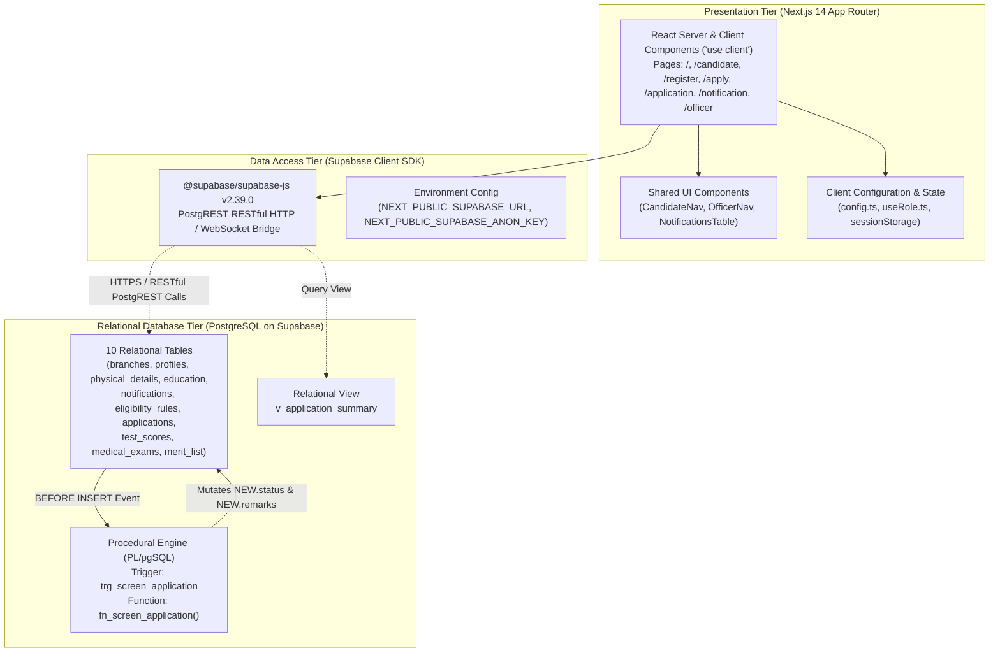
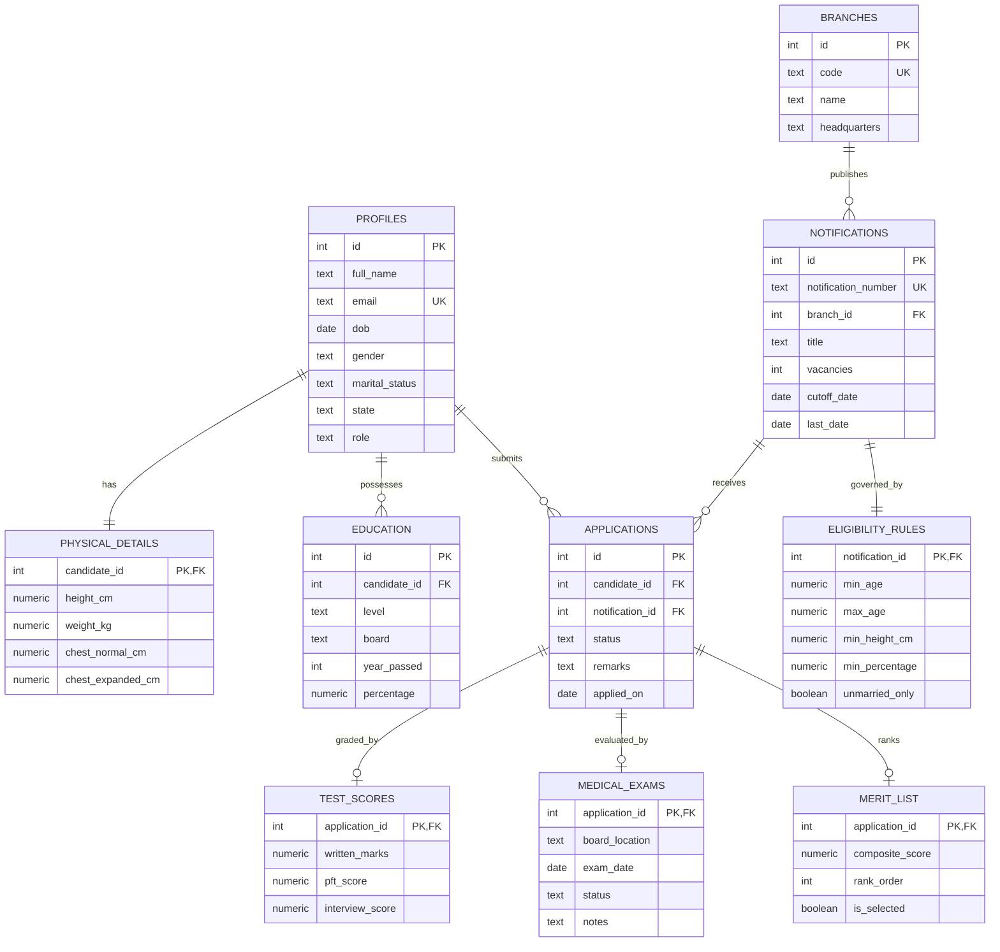
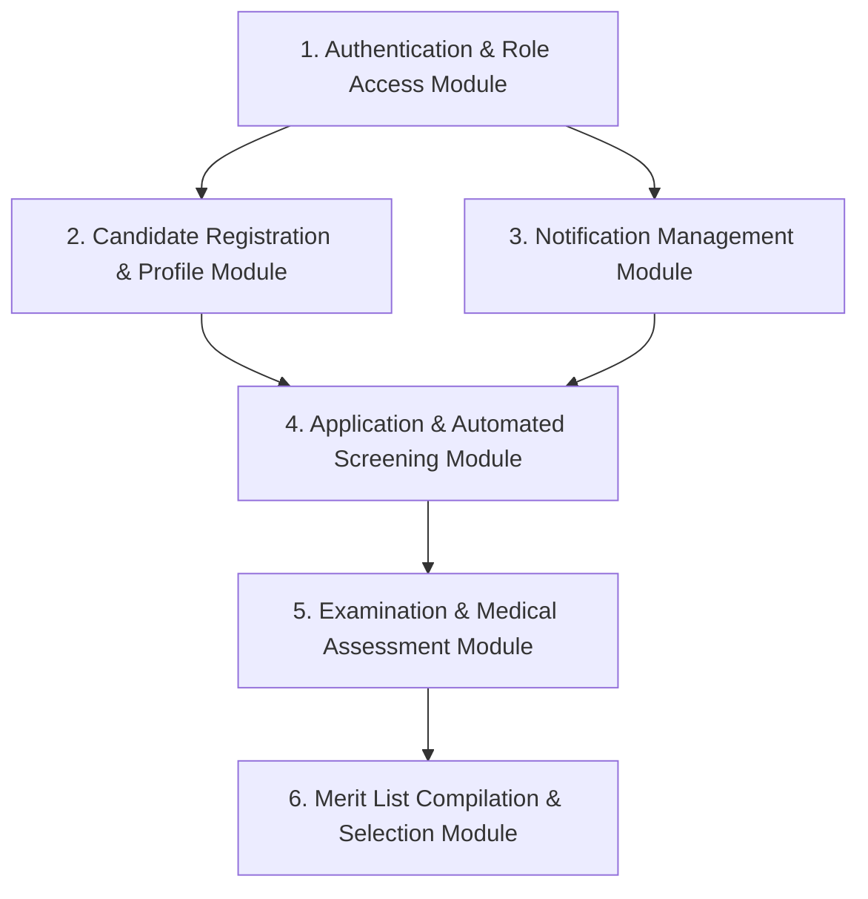

# Comprehensive DBMS Project Analysis and Technical Report

---

## 1. Abstract

The **Defence Recruitment and Eligibility Management System (DREMS)** is a specialized relational database application engineered to streamline, digitize, and automate candidate selection processes across defence service branches. Designed as a full-stack database-centric application, the system integrates a **PostgreSQL** relational database backend (deployed on **Supabase**) with a **Next.js 14** (React 18 / TypeScript) presentation layer. 

The core architectural objective is shifting complex business logic—specifically recruitment eligibility verification—into the database tier through an event-driven **PostgreSQL PL/pgSQL BEFORE INSERT trigger** (`trg_screen_application`). By enforcing multidimensional eligibility criteria (age computation relative to dynamic cutoff dates, minimum physical stature, marital status verification, and academic percentage thresholds) directly at the database engine level, the system eliminates human subjectivity, minimizes processing latency, and guarantees strict domain integrity. Post-screening administrative workflows—including physical fitness test (PFT) recording, written examination scoring, interview grading, board medical reviews, and weighted composite merit list generation with dense ranking—are executed via the Supabase PostgREST data access layer. 

This technical report delivers a comprehensive, evidence-backed evaluation of DREMS, detailing its relational schema, normal forms, stored procedures, client-side algorithms, communication flows, security mechanisms, verified implementation artifacts, and current architectural constraints.

---

## 2. Introduction

Recruitment into defence establishments (e.g., Army, Navy, Air Force, Coast Guard) demands stringent adherence to physical, educational, demographic, and medical benchmarks. Manual screening of large volumes of applicant records frequently suffers from operational bottlenecks, cross-branch inconsistencies, human data-entry errors, and lack of auditable data trails.

DREMS addresses these operational challenges by implementing a normalized relational data model combined with automated database triggers and analytical views. Rather than treating the database simply as an inert data repository, DREMS leverages PostgreSQL's programmable features to enforce domain-specific recruitment rules at the point of insertion. The application segregates workflows into two operational actors: **Candidates**, who register demographic, physical, and academic credentials to apply for commission notifications; and **Recruitment Officers**, who administer vacancy notices, grade tests, log board medical assessments, and execute vacancy-bounded merit selections.

---

## 3. Problem Statement

Traditional defence recruitment processes and basic management systems present several persistent flaws:
1. **Error-Prone Manual Eligibility Validation:** Calculating an applicant's exact age against variable commission cutoff dates, validating height thresholds, checking marital prerequisites, and determining academic qualification compliance by hand introduces processing errors and delays.
2. **Coupling Logic in Client/Application Code:** When eligibility rules are scattered across frontend validation scripts or intermediate servers, inconsistent rule enforcement, bypass vulnerabilities, and synchronization failures arise whenever criteria are modified.
3. **Decoupled Medical and Score Aggregation:** Selection stages (written marks, physical fitness tests, interview scores, and military medical boards) often operate in isolation, making composite rank calculation and vacancy-based selection complex and susceptible to clerical errors.
4. **Data Integrity Hazards:** In the absence of strict database-level check constraints and assertions, invalid physical metrics (e.g., chest expansion values lower than normal chest measurements or impossible height/weight entries) can contaminate the recruitment database.

---

## 4. Objectives

The primary objectives of the DREMS project, as verified from the repository implementation, include:
- **Centralize Multi-Branch Recruitment Data:** Store notifications, candidate profiles, physical measurements, academic histories, examination results, and board medical reports within a single relational database.
- **Implement Database-Enforced Automated Screening:** Execute an automated PL/pgSQL trigger prior to application persistence to evaluate eligibility against notification criteria and assign an immediate `ELIGIBLE` or `REJECTED` status with granular explanatory remarks.
- **Enforce Strict Relational and Domain Integrity:** Utilize SQL primary keys, foreign keys with cascading updates/deletions, unique constraints, and check constraints (`CHECK`) to prevent invalid physical, demographic, and educational data entry.
- **Provide Unified Recruitment Reporting:** Construct database views (`v_application_summary`) that join profile, notification, testing, and medical data to provide a unified tracking interface for both candidates and officers.
- **Automate Weighted Composite Ranking:** Implement a standardized mathematical formulation ($40\%$ written $+ 20\%$ PFT $+ 40\%$ interview) to generate an auditable merit list using dense ranking while filtering out medically unfit or incomplete candidates.

---

## 5. Existing System vs. Proposed System

| Dimension | Existing / Conventional System | Proposed DREMS Implementation |
|---|---|---|
| **Eligibility Verification** | Manual physical document scrutiny or client-side JavaScript checks. | Automated PostgreSQL PL/pgSQL `BEFORE INSERT` trigger (`fn_screen_application`) executing inside the database engine. |
| **Integrity Enforcement** | Dispersed application-level validation; invalid records frequently bypass frontend forms. | Database-level constraints: Foreign keys, `CHECK` constraints (e.g., `chest_expanded_cm >= chest_normal_cm`), and `UNIQUE` constraints. |
| **Data Architecture** | Disconnected spreadsheets, siloed application tables, or unnormalized files. | 10 normalized relational tables in PostgreSQL with defined foreign key cascades. |
| **Reporting & Querying** | Ad-hoc queries requiring manual, multi-table joining by end-users. | Encapsulated relational view (`v_application_summary`) providing instant cross-module reporting. |
| **Merit List Compilation** | Manual ledger calculations subject to rounding inconsistencies and human bias. | Deterministic weighted scoring algorithm with automatic dense rank assignment and vacancy-based selection cutoff. |
| **Candidate Feedback** | Delayed physical letters or opaque rejection notifications without stated causes. | Immediate database-generated rejection remarks (e.g., *"Height too low."*, *"Age not in range."*) recorded upon submission. |

---

## 6. System Requirements

### Hardware Requirements (Development and Deployment)
- **Processor:** Modern x86-64 or ARM64 multi-core processor (minimum 2 physical cores, 2.0 GHz or higher).
- **Primary Memory (RAM):** 4 GB minimum; 8 GB recommended for concurrent Next.js compilation and local browser execution.
- **Storage:** 500 MB free disk space for source files, node runtime modules, and cached build artifacts.
- **Display Resolution:** Minimum $1024 \times 768$ screen resolution.

### Software Requirements
- **Operating System:** Platform-agnostic (Windows 10/11, Linux, or macOS).
- **Runtime Environment:** Node.js version 18.x or 20.x LTS.
- **Package Manager:** `npm` (version 9.x or higher).
- **Database Engine / Backend Service:** PostgreSQL 15+ hosted on Supabase Cloud (or local Supabase CLI instance).
- **Modern Web Browser:** Google Chrome, Mozilla Firefox, Microsoft Edge, or Safari with ECMAScript 2020+ and Web Storage (`sessionStorage`) support.

---

## 7. Technology Stack Analysis



### Verified Technology Inventory

1. **Database Tier:**
   - **PostgreSQL (Supabase Managed):** Serves as the relational DBMS. Implements relational schemas, primary/foreign key constraints, domain checks, a procedural PL/pgSQL function (`fn_screen_application`), a `BEFORE INSERT` trigger, and an analytical view (`v_application_summary`).
   - **PostgREST (Supabase Backend Engine):** Automatically generates RESTful HTTP endpoints exposing relational tables and views over HTTPS directly to the client SDK.

2. **Frontend & Application Tier:**
   - **Next.js (v14.2.3):** Modern React meta-framework utilizing the App Router architecture (`src/app`). Employs Client Components (`'use client'`) across all interactive routes to handle state and lifecycle hooks.
   - **React (v18.0.0+ / react-dom v18.0.0+):** Component library rendering dynamic, reactive user interface elements, state-driven tables, and conditional role-based views.
   - **TypeScript (v5.x):** Provides static typing across frontend interfaces (`NotificationRow`, `ApplicationSummary`, `RankedCandidate`, `Branch`, `CandidateOption`).
   - **CSS3 (Pure Modular Stylesheet):** Implemented via `src/app/globals.css`, defining CSS grid layouts, flexboxes, table styles, responsive breakpoints, and status indicators without reliance on third-party CSS utility frameworks.

3. **Data Access & Client Libraries:**
   - **`@supabase/supabase-js` (v2.39.0):** Official isomorphic JavaScript/TypeScript client library used to query, insert, update, delete, and upsert records into PostgreSQL via PostgREST.

4. **Tooling & Configuration:**
   - **ESLint (v8.x with `eslint-config-next` 14.2.3):** Static code analysis and linting.
   - **TypeScript Compiler (`tsc`):** Type resolution and incremental compilation tracking via `tsconfig.json`.

---

## 8. System Architecture Design

DREMS is architected around a **Two-Tier Client-to-BaaS (Backend-as-a-Service) Model**, where the frontend client communicates directly with PostgreSQL via the Supabase PostgREST gateway without an intermediate custom application server (e.g., Express or Django).

### Detailed Architectural Layers

1. **Presentation Layer (Next.js App Router):**
   - Implemented within `frontend/src/app`.
   - Organizes interfaces into role-isolated route segments: Candidate workflows (`/candidate`, `/register`, `/notifications`, `/apply`, `/application`) and Officer workflows (`/notification`, `/officer`).
   - Handles client-side role isolation using the custom hook `useRole` (`frontend/src/lib/useRole.ts`), querying browser `sessionStorage`.

2. **Data Communication & Transport Layer (Supabase PostgREST Bridge):**
   - Instantiated in `frontend/src/lib/supabase.ts` via `createClient(supabaseUrl, supabaseAnonKey)`.
   - Translates client-side JavaScript method chains (`supabase.from('applications').insert(...)`) into parameterized HTTP requests directed to Supabase endpoints.

3. **Business Logic Tier (Hybrid Distribution):**
   - **Database-Side Business Logic:** Eligibility screening rules are fully encapsulated in PostgreSQL through `fn_screen_application()`. This ensures that any insert into `applications` is screened consistently, regardless of frontend state.
   - **Client-Side Business Logic:** Merit list compilation, composite score calculation, sorting, and dense ranking are implemented in TypeScript inside the Officer controller (`frontend/src/app/officer/page.tsx`).

4. **Data Persistence Tier (PostgreSQL Relational Storage):**
   - Manages relational tables, checks integrity constraints, handles cascading updates/deletes, executes procedural triggers, and materializes views on query.

---

## 9. Database Design and DBMS Analysis

The database consists of **10 base tables**, **1 analytical view**, **1 procedural trigger function**, and **1 fixed seed dataset**.

### 9.1 Relational Tables and Field Specifications

#### Table 1: `branches`
Stores the armed service branches offering recruitment commissions.
- **Role:** Lookup table defining organizational branches.

| Column Name | Data Type | Constraints | Description / Purpose |
|---|---|---|---|
| `id` | `SERIAL` | `PRIMARY KEY` | Unique synthetic identifier for the service branch. |
| `code` | `TEXT` | `NOT NULL, UNIQUE` | Branch identifier code (e.g., `'ARMY'`, `'NAVY'`). |
| `name` | `TEXT` | `NOT NULL` | Full display name (e.g., `'Indian Army'`). |
| `headquarters` | `TEXT` | `DEFAULT 'New Delhi'` | Administrative headquarters location. |

#### Table 2: `profiles`
Stores master demographic and identity records for all system participants.
- **Role:** Central entity for candidate and officer personal details.

| Column Name | Data Type | Constraints | Description / Purpose |
|---|---|---|---|
| `id` | `SERIAL` | `PRIMARY KEY` | Unique synthetic profile identifier. |
| `full_name` | `TEXT` | `NOT NULL` | Candidate's legal full name. |
| `email` | `TEXT` | `NOT NULL, UNIQUE` | Unique email address; serves as candidate login/lookup identifier. |
| `dob` | `DATE` | `NOT NULL` | Date of birth for age calculation. |
| `gender` | `TEXT` | `NOT NULL, CHECK (gender IN ('MALE', 'FEMALE', 'OTHER'))` | Biological gender category. |
| `marital_status`| `TEXT` | `NOT NULL, DEFAULT 'UNMARRIED', CHECK (marital_status IN ('UNMARRIED', 'MARRIED', 'DIVORCED', 'WIDOWED'))` | Marital status for eligibility checks. |
| `state` | `TEXT` | `NOT NULL` | Domicile state of the candidate. |
| `role` | `TEXT` | `NOT NULL, DEFAULT 'CANDIDATE', CHECK (role IN ('CANDIDATE', 'OFFICER'))` | System access role classification. |

#### Table 3: `physical_details`
Stores anthropometric and physical measurements of candidates.
- **Role:** Child entity of `profiles` ($1:1$ relationship) containing physiological screening attributes.

| Column Name | Data Type | Constraints | Description / Purpose |
|---|---|---|---|
| `candidate_id` | `INT` | `PRIMARY KEY, REFERENCES profiles(id) ON DELETE CASCADE` | Foreign key referencing `profiles.id`. |
| `height_cm` | `NUMERIC(5,1)`| `NOT NULL, CHECK (height_cm BETWEEN 130 AND 230)` | Standing height in centimeters. |
| `weight_kg` | `NUMERIC(5,1)`| `NOT NULL, CHECK (weight_kg BETWEEN 35 AND 150)` | Body weight in kilograms. |
| `chest_normal_cm`| `NUMERIC(5,1)`| `NULL` | Chest circumference during normal exhalation (cm). |
| `chest_expanded_cm`| `NUMERIC(5,1)`| `NULL` | Chest circumference during deep inhalation (cm). |
| *Table Constraint* | `CONSTRAINT chk_chest` | `CHECK (chest_expanded_cm >= chest_normal_cm)` | Integrity assertion: expanded chest cannot be less than normal chest. |

#### Table 4: `education`
Stores academic records and qualifications across multiple levels.
- **Role:** Weak child entity of `profiles` ($1:N$ relationship) capturing educational progression.

| Column Name | Data Type | Constraints | Description / Purpose |
|---|---|---|---|
| `id` | `SERIAL` | `PRIMARY KEY` | Unique qualification record identifier. |
| `candidate_id` | `INT` | `NOT NULL, REFERENCES profiles(id) ON DELETE CASCADE` | Foreign key linking qualification to `profiles.id`. |
| `level` | `TEXT` | `NOT NULL, CHECK (level IN ('10TH', '12TH', 'GRADUATION'))`| Tier of academic qualification. |
| `board` | `TEXT` | `NOT NULL` | Educational board or university name. |
| `year_passed` | `INT` | `NOT NULL` | Calendar year of passing. |
| `percentage` | `NUMERIC(5,2)`| `NOT NULL, CHECK (percentage BETWEEN 0 AND 100)` | Aggregate marks percentage obtained. |

#### Table 5: `notifications`
Represents official recruitment notices published by defence branches.
- **Role:** Parent recruitment entity defining timelines and openings.

| Column Name | Data Type | Constraints | Description / Purpose |
|---|---|---|---|
| `id` | `SERIAL` | `PRIMARY KEY` | Unique notification identifier. |
| `notification_number` | `TEXT` | `NOT NULL, UNIQUE` | Official gazette notice number (e.g., `'NDA-155-2026'`). |
| `branch_id` | `INT` | `NOT NULL, REFERENCES branches(id)` | Foreign key linking notification to service branch. |
| `title` | `TEXT` | `NOT NULL` | Title of commission course or entry. |
| `vacancies` | `INT` | `NOT NULL, CHECK (vacancies > 0)` | Total sanctioned intake vacancies. |
| `cutoff_date` | `DATE` | `NOT NULL` | Baseline date against which applicant age is evaluated. |
| `last_date` | `DATE` | `NOT NULL` | Deadline for application submission. |

#### Table 6: `eligibility_rules`
Defines the parameterized eligibility criteria for each recruitment notification.
- **Role:** Direct extension of `notifications` ($1:1$ relationship) housing rule parameters for the trigger function.

| Column Name | Data Type | Constraints | Description / Purpose |
|---|---|---|---|
| `notification_id` | `INT` | `PRIMARY KEY, REFERENCES notifications(id) ON DELETE CASCADE` | Foreign key referencing `notifications.id`. |
| `min_age` | `NUMERIC(4,1)`| `NOT NULL` | Minimum permitted age (years) on cutoff date. |
| `max_age` | `NUMERIC(4,1)`| `NOT NULL` | Maximum permitted age (years) on cutoff date. |
| `min_height_cm` | `NUMERIC(5,1)`| `NOT NULL` | Minimum required height in centimeters. |
| `min_percentage`| `NUMERIC(5,2)`| `NOT NULL` | Minimum qualifying academic percentage. |
| `unmarried_only`| `BOOLEAN` | `NOT NULL, DEFAULT TRUE` | Flag mandating unmarried status. |

#### Table 7: `applications`
Records candidate submissions against specific recruitment notifications.
- **Role:** Associative entity connecting `profiles` and `notifications` ($M:N$ resolution).

| Column Name | Data Type | Constraints | Description / Purpose |
|---|---|---|---|
| `id` | `SERIAL` | `PRIMARY KEY` | Unique application identifier. |
| `candidate_id` | `INT` | `NOT NULL, REFERENCES profiles(id) ON DELETE CASCADE` | Foreign key referencing applicant profile. |
| `notification_id`| `INT` | `NOT NULL, REFERENCES notifications(id)` | Foreign key referencing target notification. |
| `status` | `TEXT` | `NOT NULL, DEFAULT 'SUBMITTED', CHECK (status IN ('SUBMITTED', 'ELIGIBLE', 'REJECTED', 'SELECTED'))` | Current lifecycle status of application. |
| `remarks` | `TEXT` | `NULL` | Automated screening feedback or rejection rationale. |
| `applied_on` | `DATE` | `NOT NULL, DEFAULT CURRENT_DATE` | Timestamp of application submission. |
| *Table Constraint* | `UNIQUE (candidate_id, notification_id)` | Prevents duplicate applications by a candidate for the same notification. |

#### Table 8: `test_scores`
Stores performance marks across written, physical, and interview evaluations.
- **Role:** Dependent entity of `applications` ($1:1$ relationship) containing examination metrics.

| Column Name | Data Type | Constraints | Description / Purpose |
|---|---|---|---|
| `application_id` | `INT` | `PRIMARY KEY, REFERENCES applications(id) ON DELETE CASCADE` | Foreign key linking marks to `applications.id`. |
| `written_marks` | `NUMERIC(5,2)`| `NOT NULL, CHECK (written_marks BETWEEN 0 AND 100)` | Written examination score ($0-100$). |
| `pft_score` | `NUMERIC(5,2)`| `NOT NULL, CHECK (pft_score BETWEEN 0 AND 100)` | Physical Fitness Test score ($0-100$). |
| `interview_score`| `NUMERIC(5,2)`| `NOT NULL, CHECK (interview_score BETWEEN 0 AND 100)`| SSB/Officer Interview score ($0-100$). |

#### Table 9: `medical_exams`
Stores medical board findings and fitness determinations for applicants.
- **Role:** Dependent entity of `applications` ($1:1$ relationship) recording clinical fitness.

| Column Name | Data Type | Constraints | Description / Purpose |
|---|---|---|---|
| `application_id` | `INT` | `PRIMARY KEY, REFERENCES applications(id) ON DELETE CASCADE` | Foreign key referencing `applications.id`. |
| `board_location` | `TEXT` | `NOT NULL` | Military Hospital or Medical Board center name. |
| `exam_date` | `DATE` | `NOT NULL` | Date of clinical medical assessment. |
| `status` | `TEXT` | `NOT NULL, DEFAULT 'PENDING', CHECK (status IN ('PENDING', 'FIT', 'UNFIT'))` | Medical board clearance status. |
| `notes` | `TEXT` | `NULL` | Medical observations or condition summaries. |

#### Table 10: `merit_list`
Stores finalized merit standings, composite evaluation scores, and selection decisions.
- **Role:** Dependent entity of `applications` ($1:1$ relationship) holding ranked competition outcomes.

| Column Name | Data Type | Constraints | Description / Purpose |
|---|---|---|---|
| `application_id` | `INT` | `PRIMARY KEY, REFERENCES applications(id) ON DELETE CASCADE` | Foreign key linking standing to `applications.id`. |
| `composite_score`| `NUMERIC(5,2)`| `NOT NULL` | Weighted aggregate score ($40\%$ written $+ 20\%$ PFT $+ 40\%$ interview). |
| `rank_order` | `INT` | `NOT NULL` | Calculated dense rank position. |
| `is_selected` | `BOOLEAN` | `NOT NULL` | True if rank falls within sanctioned vacancies. |

---

### 9.2 Procedural Logic: The Screening Trigger

The defining database mechanism in DREMS is the automated screening trigger defined in `supabase_schema.sql` (Lines 110–155):

```sql
CREATE FUNCTION fn_screen_application() RETURNS TRIGGER AS $$
DECLARE
    r        eligibility_rules%ROWTYPE;
    v_age    NUMERIC;
    v_height NUMERIC;
    v_marital TEXT;
    v_pct    NUMERIC;
    v_why    TEXT := '';
BEGIN
    SELECT * INTO r FROM eligibility_rules WHERE notification_id = NEW.notification_id;

    SELECT (n.cutoff_date - p.dob) / 365.25, ph.height_cm, p.marital_status
    INTO v_age, v_height, v_marital
    FROM profiles p
    LEFT JOIN physical_details ph ON ph.candidate_id = p.id
    JOIN notifications n ON n.id = NEW.notification_id
    WHERE p.id = NEW.candidate_id;

    -- marks of the most recent qualification
    SELECT percentage INTO v_pct FROM education
    WHERE candidate_id = NEW.candidate_id
    ORDER BY year_passed DESC LIMIT 1;

    IF v_age < r.min_age OR v_age > r.max_age THEN
        v_why := v_why || 'Age not in range. ';
    END IF;
    IF v_height IS NULL OR v_height < r.min_height_cm THEN
        v_why := v_why || 'Height too low. ';
    END IF;
    IF r.unmarried_only AND v_marital <> 'UNMARRIED' THEN
        v_why := v_why || 'Must be unmarried. ';
    END IF;
    IF v_pct IS NULL OR v_pct < r.min_percentage THEN
        v_why := v_why || 'Marks too low. ';
    END IF;

    NEW.remarks := NULLIF(trim(v_why), '');
    NEW.status  := CASE WHEN v_why = '' THEN 'ELIGIBLE' ELSE 'REJECTED' END;
    RETURN NEW;
END;
$$ LANGUAGE plpgsql;

CREATE TRIGGER trg_screen_application
BEFORE INSERT ON applications
FOR EACH ROW EXECUTE FUNCTION fn_screen_application();
```

#### Trigger Mechanics and Invariants:
1. **Execution Point:** Runs `BEFORE INSERT` on the `applications` table for each inserted row (`FOR EACH ROW`).
2. **Age Calculation:** Derives exact age via `(n.cutoff_date - p.dob) / 365.25`, factoring in Julian year leap-day distribution relative to notification-specific cutoff dates.
3. **Academic Evaluation:** Executes a subquery extracting the percentage from the applicant's latest academic degree (`ORDER BY year_passed DESC LIMIT 1`).
4. **Failure Accumulation:** Concatenates explanatory rejection strings (`v_why`) across all violated parameters.
5. **State Mutation:** If `v_why` remains empty, sets `NEW.status = 'ELIGIBLE'`; otherwise sets `NEW.status = 'REJECTED'` and writes concatenated violation notes into `NEW.remarks`.

---

### 9.3 Analytical Database View: `v_application_summary`

Defined in `supabase_schema.sql` (Lines 159–174), this relational view consolidates five disjoint tables to provide a real-time summary for reporting:

```sql
CREATE VIEW v_application_summary AS
SELECT a.id AS application_id,
       p.full_name,
       n.notification_number,
       ROUND((n.cutoff_date - p.dob) / 365.25, 1) AS age_at_cutoff,
       a.status,
       a.remarks,
       t.written_marks,
       t.pft_score,
       t.interview_score,
       m.status AS medical_status
FROM applications a
JOIN profiles p ON p.id = a.candidate_id
JOIN notifications n ON n.id = a.notification_id
LEFT JOIN test_scores t ON t.application_id = a.id
LEFT JOIN medical_exams m ON m.application_id = a.id;
```

---

## 10. Entity-Relationship (ER) Diagram

The following Mermaid ER diagram illustrates the complete relational database structure, foreign key references, and cardinality constraints implemented in PostgreSQL:



### Cardinality and Structural Analysis
- `BRANCHES` to `NOTIFICATIONS`: $1:N$ (One branch publishes multiple notifications; each notification belongs to exactly one branch).
- `PROFILES` to `PHYSICAL_DETAILS`: $1:1$ (Enforced via `candidate_id` acting simultaneously as Primary Key and Foreign Key referencing `profiles.id`).
- `PROFILES` to `EDUCATION`: $1:N$ (A candidate can register multiple sequential qualifications: 10th, 12th, and Graduation).
- `PROFILES` to `APPLICATIONS`: $1:N$ (A candidate can submit applications for different notifications).
- `NOTIFICATIONS` to `APPLICATIONS`: $1:N$ (A notification receives multiple applicant submissions).
- `APPLICATIONS` composite uniqueness: `UNIQUE (candidate_id, notification_id)` ensures that a candidate cannot submit duplicate applications for the same recruitment notice.
- `NOTIFICATIONS` to `ELIGIBILITY_RULES`: $1:1$ (Enforced via `notification_id` serving as Primary Key and Foreign Key referencing `notifications.id`).
- `APPLICATIONS` to `TEST_SCORES`, `MEDICAL_EXAMS`, and `MERIT_LIST`: $1:1$ (Optional $0..1$ to $1$ relationships; each secondary stage record references `application_id` as its primary key).

---

## 11. Relational Schema Representation

The formal mathematical relational schema for DREMS is defined below, with **Primary Keys** bolded and underlined, and *Foreign Keys* italicized:

1. **BRANCHES** (<ins>**id**</ins>, code, name, headquarters)
   - *Candidate Keys:* $\{id\}$, $\{code\}$

2. **PROFILES** (<ins>**id**</ins>, full_name, email, dob, gender, marital_status, state, role)
   - *Candidate Keys:* $\{id\}$, $\{email\}$

3. **PHYSICAL_DETAILS** (<ins>**candidate_id**</ins>*, height_cm, weight_kg, chest_normal_cm, chest_expanded_cm)
   - *Foreign Key:* `candidate_id` references **PROFILES**(`id`) ON DELETE CASCADE

4. **EDUCATION** (<ins>**id**</ins>, *candidate_id*, level, board, year_passed, percentage)
   - *Foreign Key:* `candidate_id` references **PROFILES**(`id`) ON DELETE CASCADE

5. **NOTIFICATIONS** (<ins>**id**</ins>, notification_number, *branch_id*, title, vacancies, cutoff_date, last_date)
   - *Candidate Keys:* $\{id\}$, $\{notification_number\}$
   - *Foreign Key:* `branch_id` references **BRANCHES**(`id`)

6. **ELIGIBILITY_RULES** (<ins>**notification_id**</ins>*, min_age, max_age, min_height_cm, min_percentage, unmarried_only)
   - *Foreign Key:* `notification_id` references **NOTIFICATIONS**(`id`) ON DELETE CASCADE

7. **APPLICATIONS** (<ins>**id**</ins>, *candidate_id*, *notification_id*, status, remarks, applied_on)
   - *Candidate Keys:* $\{id\}$, $\{candidate_id, notification_id\}$
   - *Foreign Keys:* 
     - `candidate_id` references **PROFILES**(`id`) ON DELETE CASCADE
     - `notification_id` references **NOTIFICATIONS**(`id`)

8. **TEST_SCORES** (<ins>**application_id**</ins>*, written_marks, pft_score, interview_score)
   - *Foreign Key:* `application_id` references **APPLICATIONS**(`id`) ON DELETE CASCADE

9. **MEDICAL_EXAMS** (<ins>**application_id**</ins>*, board_location, exam_date, status, notes)
   - *Foreign Key:* `application_id` references **APPLICATIONS**(`id`) ON DELETE CASCADE

10. **MERIT_LIST** (<ins>**application_id**</ins>*, composite_score, rank_order, is_selected)
    - *Foreign Key:* `application_id` references **APPLICATIONS**(`id`) ON DELETE CASCADE

---

## 12. Normalization Analysis

A formal normalization analysis of the DREMS relational schema indicates adherence to high normal forms across core operational tables, with minor design trade-offs made in the candidate qualifications entity.

### First Normal Form (1NF)
- **Criterion:** Every attribute contains only atomic (indivisible) values; no repeating groups or multivalued arrays exist.
- **Verification:** All attributes in the schema use primitive atomic types (`TEXT`, `NUMERIC`, `DATE`, `BOOLEAN`, `INT`). Multivalued education history is properly split into individual rows in the `education` relation rather than stored as an array or comma-delimited string within `profiles`.
- **Conclusion:** **1NF is fully satisfied.**

### Second Normal Form (2NF)
- **Criterion:** The relation must be in 1NF, and all non-prime attributes must be fully functionally dependent on the entire candidate key (no partial dependencies on composite keys).
- **Verification:** 
  - In tables with single-column surrogate primary keys (`branches`, `profiles`, `education`, `notifications`, `applications`, `physical_details`, `eligibility_rules`, `test_scores`, `medical_exams`, `merit_list`), partial dependencies are impossible.
  - In `applications`, which has a composite alternative key $\{candidate_id, notification_id\}$, non-key attributes (`status`, `remarks`, `applied_on`) depend on the specific candidate-notification pair, not on `candidate_id` or `notification_id` alone.
- **Conclusion:** **2NF is fully satisfied.**

### Third Normal Form (3NF)
- **Criterion:** The relation must be in 2NF, and no non-prime attribute may be transitively dependent on a primary key ($X \rightarrow Y$ where $Y$ is non-prime and $X$ is not a superkey).
- **Verification:**
  - Non-prime attributes across `profiles`, `physical_details`, `notifications`, and `test_scores` depend directly on their respective primary keys without intermediate transitive functional dependencies.
  - In `applications`, `status` and `remarks` are functionally determined by the profile and notification data at the moment of insertion via the trigger. However, because `status` and `remarks` can evolve across the recruitment lifecycle (e.g., updating to `SELECTED` when merit lists are compiled), they represent distinct lifecycle states rather than transitive dependencies.
- **Conclusion:** **3NF is fully satisfied.**

### Analytical Observations and Normalization Considerations
1. **Academic Records Multi-Record Dependency:** The trigger function executes:
   ```sql
   SELECT percentage INTO v_pct FROM education
   WHERE candidate_id = NEW.candidate_id
   ORDER BY year_passed DESC LIMIT 1;
   ```
   If a candidate registers multiple qualifications (e.g., both 10th and 12th in the same graduation entry year), the resolution of the "most recent" qualification relies on row ordering rather than an explicit hierarchical schema indicator. A strictly normalized academic design would enforce a composite unique constraint `UNIQUE (candidate_id, level)`.
2. **Merit List Redundancy vs. Materialization:** In `merit_list`, the attribute `composite_score` is a derived value ($0.4 \times written + 0.2 \times pft + 0.4 \times interview$). Storing derived computational values technically diverges from classical Boyce-Codd Normal Form (BCNF) / 3NF purity; however, it is a standard relational design practice for persistent reporting snapshots.

---

## 13. Application Modules and Functionalities

DREMS is organized into **six functional modules**:



### Module 1: Authentication and Role Access Control
- **Source Files:** `frontend/src/app/page.tsx`, `frontend/src/lib/config.ts`, `frontend/src/lib/useRole.ts`
- **Responsibilities:** Provides initial role selection on the landing page (`/`). Officers must enter a 4-digit verification code (`OFFICER_CODE = '4827'`). Stores credentials in browser `sessionStorage` (`role: 'candidate' | 'officer'`).
- **Data Flow:** User input $\rightarrow$ Client verification against `lib/config.ts` $\rightarrow$ Write to `sessionStorage` $\rightarrow$ Next.js route navigation.

### Module 2: Candidate Registration and Profile Management
- **Source Files:** `frontend/src/app/register/page.tsx`, `frontend/src/app/candidate/page.tsx`
- **Responsibilities:** Manages the registration form capturing personal details, physical measurements, and educational background. Coordinates multi-table inserts into `profiles`, `physical_details`, and `education`. Includes a secondary form to append additional qualifications to existing profiles.
- **Data Flow:** Form submission $\rightarrow$ Sequential inserts to `profiles` $\rightarrow$ `physical_details` $\rightarrow$ `education` via `@supabase/supabase-js`.

### Module 3: Notification Management (Officer & Candidate)
- **Source Files:** `frontend/src/app/notification/page.tsx`, `frontend/src/app/notifications/page.tsx`, `frontend/src/components/NotificationsTable.tsx`
- **Responsibilities:** Officers can view, publish, and edit recruitment notices and eligibility rules (`notifications` and `eligibility_rules`). Candidates have read-only access to browse active openings and eligibility criteria.
- **Data Flow:** Read operations query joined `branches` and `eligibility_rules`. Write operations execute atomic inserts or updates into `notifications` and `eligibility_rules`.

### Module 4: Application Submission and Automated Screening
- **Source Files:** `frontend/src/app/apply/page.tsx`, `frontend/src/app/application/page.tsx`
- **Responsibilities:** Candidates identify their profile by registered email, select an open recruitment notification, and submit an application. The database trigger automatically executes screening logic and returns an immediate status (`ELIGIBLE` or `REJECTED`) along with explanatory remarks.
- **Data Flow:** Insert into `applications` $\rightarrow$ PostgreSQL `BEFORE INSERT` trigger executes $\rightarrow$ Returned row reflects calculated `status` and `remarks` $\rightarrow$ Rendered in candidate UI.

### Module 5: Test Scoring and Medical Assessment (Officer Panel)
- **Source Files:** `frontend/src/app/officer/page.tsx`
- **Responsibilities:** Officers enter written examination marks ($0-100$), Physical Fitness Test scores ($0-100$), and SSB interview marks ($0-100$) into `test_scores`. Medical board officers record examination dates, locations, fitness determinations (`FIT`, `UNFIT`, `PENDING`), and clinical notes into `medical_exams`.
- **Data Flow:** Officer input $\rightarrow$ Supabase `upsert` queries targeting `test_scores` and `medical_exams` using `application_id`.

### Module 6: Merit List Compilation and Selection Engine
- **Source Files:** `frontend/src/app/officer/page.tsx` (Lines 210–320)
- **Responsibilities:** Calculates weighted composite scores ($40\%$ written $+ 20\%$ PFT $+ 40\%$ interview), excludes applicants who are medically `UNFIT` or have incomplete scores, computes dense ranks, allocates selections based on vacancies, persists outcomes into `merit_list`, and updates `applications.status` to `SELECTED`.
- **Data Flow:** Batch query of eligible candidates $\rightarrow$ TypeScript computation of composite scores $\rightarrow$ Dense rank assignment $\rightarrow$ Clear prior records in `merit_list` $\rightarrow$ Batch insert into `merit_list` $\rightarrow$ Bulk update of `applications.status`.

---

## 14. Application Workflow and Data Flow

```mermaid
sequenceDiagram
    autonumber
    actor Candidate
    actor Officer
    participant UI as Next.js Presentation Layer
    participant SDK as Supabase Client (PostgREST)
    participant DB as PostgreSQL Database Engine
    participant Trigger as trg_screen_application

    Note over Candidate, DB: Phase 1: Candidate Registration & Profile Creation
    Candidate->>UI: Fills Profile, Physical, Education Data (/register)
    UI->>SDK: Insert into profiles
    SDK->>DB: INSERT INTO profiles RETURNING id
    DB-->>SDK: Returns candidateId
    UI->>SDK: Insert into physical_details & education
    SDK->>DB: INSERT INTO physical_details; INSERT INTO education;

    Note over Officer, DB: Phase 2: Notification & Eligibility Rule Configuration
    Officer->>UI: Enters Notification & Eligibility Rules (/notification)
    UI->>SDK: Insert notifications & eligibility_rules
    SDK->>DB: INSERT INTO notifications; INSERT INTO eligibility_rules;

    Note over Candidate, DB: Phase 3: Application Submission & Automated Screening
    Candidate->>UI: Submits Application (/apply)
    UI->>SDK: INSERT INTO applications (candidate_id, notification_id)
    SDK->>DB: INSERT INTO applications
    DB->>Trigger: Fires BEFORE INSERT (fn_screen_application)
    Trigger->>DB: Query cutoff date, DOB, physical height, latest qualification
    Trigger->>Trigger: Evaluate Age, Height, Marital Status, Marks
    Trigger-->>DB: Mutate NEW.status ('ELIGIBLE' / 'REJECTED') & NEW.remarks
    DB-->>SDK: Application row saved & returned
    SDK-->>UI: Displays Immediate Screening Result

    Note over Officer, DB: Phase 4: Scoring, Medical Clearance & Merit Ranking
    Officer->>UI: Enter Test Scores & Medical Results (/officer)
    UI->>SDK: Upsert test_scores & medical_exams
    SDK->>DB: UPSERT test_scores; UPSERT medical_exams;
    Officer->>UI: Clicks 'Generate Merit List'
    UI->>SDK: Query eligible applicants with scores and medical status
    SDK->>DB: SELECT from applications JOIN test_scores JOIN medical_exams
    DB-->>UI: Return dataset
    UI->>UI: Exclude UNFIT, calculate composite score, assign dense ranks
    UI->>SDK: Delete existing merit_list rows & Insert new merit_list rows
    SDK->>DB: DELETE FROM merit_list; INSERT INTO merit_list;
    UI->>SDK: Update applications.status to 'SELECTED' or 'ELIGIBLE'
    SDK->>DB: UPDATE applications SET status = ...
```

---

## 15. API and Communication Layer Analysis

DREMS does not implement custom Next.js API Route Handlers (i.e., there are no files within `frontend/src/app/api/`). Instead, the presentation tier relies entirely on client-side calls via the `@supabase/supabase-js` SDK, which communicates with Supabase's auto-generated **PostgREST HTTP REST API**.

### Verified Endpoints & PostgREST Operations

| Target Resource | HTTP Method | Initiating Component / File | Payload / Input | Returned Data | Database Operation / Stored Logic |
|---|---|---|---|---|---|
| `/rest/v1/profiles` | `GET` | `register/page.tsx:53`, `apply/page.tsx:78`, `application/page.tsx:103` | Filter: `email=eq.<email>`, `role=eq.CANDIDATE` | Profile records (`id, full_name, email`) | `SELECT id, full_name, email FROM profiles WHERE email = ?` |
| `/rest/v1/profiles` | `POST` | `register/page.tsx:82` | JSON object: `full_name, email, dob, gender, marital_status, state, role` | Created row: `id` | `INSERT INTO profiles (...) VALUES (...) RETURNING id` |
| `/rest/v1/physical_details` | `POST` | `register/page.tsx:100` | JSON object: `candidate_id, height_cm, weight_kg, chest_normal_cm, chest_expanded_cm` | Status flag / error | `INSERT INTO physical_details (...) VALUES (...)` |
| `/rest/v1/education` | `POST` | `register/page.tsx:113`, `register/page.tsx:164` | JSON object: `candidate_id, level, board, year_passed, percentage` | Status flag / error | `INSERT INTO education (...) VALUES (...)` |
| `/rest/v1/notifications` | `GET` | `notifications/page.tsx:25`, `notification/page.tsx:53`, `apply/page.tsx:54` | PostgREST join syntax: `*, branches(name), eligibility_rules(*)` | Nested JSON array of notifications | Multi-table relational join between `notifications`, `branches`, and `eligibility_rules` |
| `/rest/v1/notifications` | `POST` / `PATCH` | `notification/page.tsx:139, 169` | Notification attributes (`notification_number, branch_id, title, vacancies, cutoff_date, last_date`) | Created or updated notification row | `INSERT INTO notifications` or `UPDATE notifications WHERE id = ?` |
| `/rest/v1/eligibility_rules`| `POST` / `PUT` | `notification/page.tsx:151, 186` | Eligibility attributes (`notification_id, min_age, max_age, min_height_cm, min_percentage, unmarried_only`) | Status flag / error | `INSERT INTO eligibility_rules` or `UPSERT (MERGE)` |
| `/rest/v1/applications` | `POST` | `apply/page.tsx:126` | JSON object: `candidate_id, notification_id` | Created row: `id, status, remarks` | `INSERT INTO applications (...) VALUES (...)` **$\rightarrow$ Fires `trg_screen_application`** |
| `/rest/v1/applications` | `PATCH` | `officer/page.tsx:305, 309` | JSON object: `status: 'SELECTED'` or `'ELIGIBLE'` | Status flag / error | Batch `UPDATE applications SET status = ? WHERE id IN (...)` |
| `/rest/v1/v_application_summary` | `GET` | `application/page.tsx:67`, `officer/page.tsx:95` | Filter: `application_id=in.(...)` or full query | Summary view records | Reads materialized view `v_application_summary` |
| `/rest/v1/test_scores` | `POST` (Upsert)| `officer/page.tsx:155` | JSON object: `application_id, written_marks, pft_score, interview_score` | Status flag / error | `INSERT ... ON CONFLICT (application_id) DO UPDATE ...` |
| `/rest/v1/medical_exams` | `POST` (Upsert)| `officer/page.tsx:188` | JSON object: `application_id, board_location, exam_date, status, notes` | Status flag / error | `INSERT ... ON CONFLICT (application_id) DO UPDATE ...` |
| `/rest/v1/merit_list` | `DELETE` / `POST` | `officer/page.tsx:292, 300` | Delete filter: `application_id=in.(...)`; Insert: JSON array of ranked applicants | Status flag / error | `DELETE FROM merit_list WHERE application_id IN (...)`; batch `INSERT INTO merit_list` |

---

## 16. Database Operations and Core Logic

### 16.1 Automated Screening Trigger Evaluation
The trigger performs automated screening across four primary domains:
$$\text{Age Validation: } \min(\text{Age}) \le \frac{\text{cutoff\_date} - \text{dob}}{365.25} \le \max(\text{Age})$$
$$\text{Height Validation: } \text{height\_cm} \ge \text{min\_height\_cm}$$
$$\text{Marital Status Validation: } (\text{unmarried\_only} = \text{TRUE} \implies \text{marital\_status} = \text{'UNMARRIED'})$$
$$\text{Academic Merit Validation: } \text{percentage}_{\text{latest}} \ge \text{min\_percentage}$$

### 16.2 Merit List Mathematical Formulation
The composite scoring algorithm in `frontend/src/app/officer/page.tsx` (Lines 255–261) computes scores using a weighted sum model:
$$\text{Composite Score} = \text{round}\Big(\big(0.40 \times \text{Written Marks}\big) + \big(0.20 \times \text{PFT Score}\big) + \big(0.40 \times \text{Interview Score}\big), \, 2\Big)$$

### 16.3 Dense Ranking Algorithm
The application calculates dense ranks sequentially:
1. Records are sorted in descending order of composite score: $\text{Applicant}_1, \text{Applicant}_2, \dots, \text{Applicant}_k$.
2. Candidate $1$ is assigned $\text{Rank} = 1$.
3. For candidate $i > 1$:
   $$\text{Rank}_i = \begin{cases} \text{Rank}_{i-1} & \text{if } \text{Score}_i = \text{Score}_{i-1} \\ \text{Rank}_{i-1} + 1 & \text{if } \text{Score}_i < \text{Score}_{i-1} \end{cases}$$
4. Selection determination:
   $$\text{is\_selected} = (\text{Rank}_i \le \text{Vacancies})$$

### 16.4 Verification SQL Queries
The repository includes `test_queries.sql`, designed for demonstration and viva evaluations:
- **Trigger Execution Demo (Query 3):** Demonstrates insertion of candidate #5 into notification #2. Because the candidate fails height criteria, the trigger writes `REJECTED` into status and `"Height too low."` into remarks.
- **Dense Rank Generation (Query 4):** Evaluates dense ranking while verifying that candidates with an `UNFIT` medical examination status are omitted from final merit selection.
- **Aggregation with Filter (Query 5):** Aggregates total applicants, passing applicants, and passing percentages per notification:
  ```sql
  SELECT n.notification_number,
         COUNT(a.id) AS applied,
         COUNT(*) FILTER (WHERE a.status <> 'REJECTED') AS passed_screening,
         ROUND(100.0 * COUNT(*) FILTER (WHERE a.status <> 'REJECTED') / NULLIF(COUNT(a.id), 0), 1) AS pass_pct
  FROM notifications n
  LEFT JOIN applications a ON a.notification_id = n.id
  GROUP BY n.notification_number;
  ```
- **Constraint Assertion Test (Query 7):** Demonstrates database constraint enforcement by attempting to insert chest measurements where expanded chest is less than normal chest:
  ```sql
  INSERT INTO physical_details VALUES (1, 175, 72, 90, 85);
  -- Fails with CHECK constraint violation: chk_chest
  ```

---

## 17. Security, Access Control, and Data Validation Analysis

## 17. Security, Access Control, and Data Validation Analysis

| Security / Validation Area | Status | Verified Implementation | Notes |
|---|---|---|---|
| **Role-Based Access Control (RBAC)** | ✅ Implemented | Custom HMAC-SHA256 JWT stored in `HttpOnly` cookie (`drems_session`). Officer role requires 4-digit `OFFICER_ACCESS_CODE` env var. JWT verified server-side on every API call in `lib/auth.ts`. | Secure against browser-console spoofing since session is `HttpOnly`. |
| **JWT Secret Management** | ✅ Fixed (BUG-11) | `SESSION_SECRET` env var is now **mandatory**. `getSecretKey()` throws an error at startup if missing — no hardcoded fallback remains. | Documented in `.env.example` with generation instructions. |
| **Middleware Route Protection** | ✅ Fixed (BUG-12) | Unauthenticated users visiting candidate routes are redirected to `/register` instead of receiving an auto-generated session cookie. | Prevents anonymous session creation. |
| **Row Level Security (RLS)** | Explicitly Disabled | Verified in `supabase_schema.sql` (Line 3): *"Row level security is left off because this is only a course demo."* | RLS commented-out policies are present in schema for future activation. |
| **SQL Injection Prevention** | ✅ Enforced | All DB calls use Supabase JS client parameterized queries via PostgREST. PL/pgSQL trigger uses static SQL. No raw string concatenation exists. | Effective protection against standard SQL injection vectors. |
| **Database Constraints & Bounds** | ✅ Fixed (BUG-05) | `chk_chest` constraint updated to be NULL-safe; enforces `chest_expanded_cm >= chest_normal_cm` only when both values are non-NULL. Height (130–230 cm), weight (35–150 kg), percentage (0–100), vacancies (>0) all enforced at DB level. | Invalid inputs rejected by PostgreSQL regardless of frontend bypass. |
| **Input Validation — Notifications API** | ✅ Fixed (BUG-08, 10) | Added `minAge < maxAge` validation and `cutoffDate ≤ lastDate` ordering validation in POST handler. | Returns HTTP 400 with descriptive error messages. |
| **DOB Validation — Registration API** | ✅ Fixed (BUG-14) | `dob` field validated as a parseable date; age must be between 10 and 60 years. | Prevents invalid DOB strings from reaching the trigger's age calculation. |
| **Application Existence Check — Scores API** | ✅ Fixed (BUG-15) | Scores API verifies `application_id` exists in the database before inserting test scores. | Returns HTTP 404 for non-existent application IDs. |
| **Registration Rollback** | ✅ Fixed (BUG-13) | If education insert fails, both `physical_details` and `profiles` are now rolled back, preventing orphaned records. | Note: not a true DB transaction — uses sequential delete calls. True atomicity requires Supabase RPC. |
| **Duplicate Application Prevention** | ✅ Enforced | `UNIQUE (candidate_id, notification_id)` in `applications` table. | Frontend catches PostgreSQL error code `23505`. |

---

## 18. Testing and Quality Assurance Analysis

### Static Inspection of Testing Infrastructure
- **Test Frameworks:** Inspection of `frontend/package.json` confirms that **no automated test runners or libraries (such as Jest, Vitest, Mocha, Cypress, or Playwright) are installed or configured.**
- **Test Scripts:** The scripts block in `frontend/package.json` contains only:
  ```json
  "scripts": {
    "dev": "next dev",
    "build": "next build",
    "start": "next start",
    "lint": "next lint"
  }
  ```
- **Automated Test Files:** No test suites (`*.test.ts`, `*.spec.tsx`) exist in the repository.
- **Manual Verification Queries:** The project provides `test_queries.sql` as a manual verification suite for academic demonstrations. It contains 7 distinct SQL queries designed to test trigger actions, view output, aggregations, subqueries, and check constraint rejections.

---

## 19. Installation, Configuration, and Execution Guide

### 19.1 Prerequisites
1. **Node.js:** v18.x or v20.x installed.
2. **Supabase Cloud Account or Local Instance:** An active PostgreSQL instance with administrative permissions.

### 19.2 Database Setup
1. Open the **SQL Editor** in the Supabase Dashboard.
2. Paste and run the entire contents of `supabase_schema.sql`.
   - This executes table cleanup, creates the 10 tables, registers the PL/pgSQL function `fn_screen_application()`, attaches the trigger `trg_screen_application` to `applications`, creates the `v_application_summary` view, and inserts seed records for the four service branches.

### 19.3 Frontend Configuration and Startup
1. Navigate to the `frontend` directory:
   ```bash
   cd frontend
   ```
2. Create and configure your local environment file:
   ```bash
   cp .env.example .env.local
   ```
3. Populate `.env.local` with your Supabase project credentials:
   ```env
   NEXT_PUBLIC_SUPABASE_URL=https://your-project-id.supabase.co
   NEXT_PUBLIC_SUPABASE_ANON_KEY=your-anon-key
   ```
4. Install dependencies:
   ```bash
   npm install
   ```
5. Launch the development server:
   ```bash
   npm run dev
   ```
6. Access the application by opening `http://localhost:3000` in your web browser.

---

## 20. Discrepancies and Inconsistencies Found in Repository

> [!NOTE]
> The bugs and loopholes identified during the initial audit have been fully resolved as of commit `1f5fedf` on 2026-11-22. See `problems.md` for the complete list. The items below reflect the state **after fixes**.

1. **`seed_data.sql` — Now Added:** Previously missing and gitignored. `seed_data.sql` with 5 fictional candidates, 2 notifications, eligibility rules, applications, test scores, and medical exams is now present in the repository and tracked by git.
2. **Accidental Root `package.json`:** The root directory contains a `package.json` with only `"dependencies": { "i": "^0.3.7" }` — a common artifact of running `npm i` without arguments in an uninitialized directory. The actual project dependencies reside entirely within `frontend/package.json`.
3. **Hardcoded Officer Code vs. Profile Roles:** The database defines a `role` column in `profiles` (`CHECK (role IN ('CANDIDATE', 'OFFICER'))`), but officer authorization is handled by the `OFFICER_ACCESS_CODE` environment variable checked in the API login route — not by querying this column.

---

## 21. Limitations and Future Scope

### 21.1 Remaining Limitations (Post Bug-Fix)
- **Supabase Client Cannot Use Transactions:** The registration flow and merit list generation perform sequential DB calls without true ACID transactions. Full atomicity requires migrating these operations to PostgreSQL stored procedures (Supabase RPC).
- **Disabled Row Level Security (RLS):** With RLS turned off, database tables are directly accessible to any client holding the public anonymous key. The commented-out RLS policies in `supabase_schema.sql` provide a blueprint but are not yet enabled.
- **Single Education Record Per Registration:** The registration form allows entry of only one education record. Candidates with multiple qualifications (10th, 12th, Graduation) must be manually added via direct SQL.
- **No Document / File Upload:** Physical certificates, medical scans, and identity documents cannot be uploaded — only text data is stored.
- **BUG-09 — cutoff_date = last_date:** Since the cutoff date UI field was removed, all new notifications use `last_date` as the age cutoff date. In real Defence recruitment, these two dates often differ.

### 21.2 Future Scope & Potential Enhancements
- **True Atomic Transactions:** Migrate registration and merit list generation to PostgreSQL stored procedures using `fn_register_candidate(...)` and `fn_generate_merit_list(p_notification_id INT)` to guarantee full ACID compliance.
- **Enable Supabase Auth & RLS:** Integrate Supabase Auth (email/OTP or OAuth) to issue proper JWTs and enable Row Level Security policies, restricting candidates to their own records.
- **Multi-Education Entry:** Allow candidates to submit all qualification levels (10th, 12th, Graduation) during registration with the trigger picking the most recent.
- **Document Storage:** Connect Supabase Storage buckets for certificate and medical report uploads with file validation.
- **Automated Test Suites:** Add Jest and Playwright tests covering API validation, trigger behavior, and UI workflows.
- **Restore Cutoff Date Field:** Re-expose the age cutoff date as an optional form field (defaulting to `last_date`) to support notifications where the two dates differ.

---

## 22. Conclusion

The **Defence Recruitment and Eligibility Management System (DREMS)** provides a database-centric, full-stack recruitment management platform with rigorous domain integrity enforcement. By embedding eligibility screening rules inside a PostgreSQL PL/pgSQL `BEFORE INSERT` trigger, the system guarantees immediate, objective candidate feedback. The normalized relational schema (10 tables, 1 trigger, 1 view), combined with server-side API routes secured by HMAC-SHA256 JWT authentication and a responsive Next.js 14 frontend, forms a cohesive architecture suitable for academic demonstration.

**Post-audit improvements applied (2026-11-22):**
- Trigger now rejects applications when no eligibility rules are configured (BUG-01)
- Exact age calculation using `AGE()` function instead of approximate 365.25 divisor (BUG-02)
- Unique constraint added to `education(candidate_id, level)` (BUG-03)
- `ON DELETE RESTRICT` added to `applications.notification_id` FK (BUG-04)
- NULL-safe chest constraint (BUG-05), explicit age cast in view (BUG-06)
- Test queries wrapped in atomic `BEGIN/ROLLBACK` (BUG-07)
- `minAge < maxAge` and `cutoffDate ≤ lastDate` validations in API (BUG-08, 10)
- Hardcoded JWT secret removed — `SESSION_SECRET` now mandatory (BUG-11)
- Middleware no longer auto-creates anonymous sessions (BUG-12)
- Full rollback on registration failure (BUG-13), DOB validation added (BUG-14)
- Application existence check before scoring (BUG-15), merit delete now error-checked (BUG-16)
- `.env.example` documents all required variables (BUG-17)
- `seed_data.sql` added to repository (BUG-18)
- Frontend hygiene: optional interface field, client-side age validation, branch reset (BUG-19, 21, 22)

Enabling Row Level Security, migrating multi-step operations to true PostgreSQL transactions, and integrating Supabase Auth will further advance DREMS toward production readiness.

---

## 23. Source Verification Table

The following table maps the technical claims made in this report directly to verified source files, code elements, and line numbers within the repository:

| Technical Claim / Feature | Source File Path | Code Element / Entity | Line Numbers | Verification Status |
|---|---|---|---|---|
| 10 Relational Tables Creation | `supabase_schema.sql` | `CREATE TABLE ...` (branches, profiles, physical_details, education, notifications, eligibility_rules, applications, test_scores, medical_exams, merit_list) | Lines 14–104 | **Verified** |
| Automated Screening Trigger Function | `supabase_schema.sql` | `FUNCTION fn_screen_application()` | Lines 110–150 | **Verified** |
| Before-Insert Trigger Declaration | `supabase_schema.sql` | `TRIGGER trg_screen_application` | Lines 152–155 | **Verified** |
| Multi-Table Summary View | `supabase_schema.sql` | `VIEW v_application_summary` | Lines 159–174 | **Verified** |
| Chest Expansion Check Constraint | `supabase_schema.sql` | `CONSTRAINT chk_chest CHECK (chest_expanded_cm >= chest_normal_cm)` | Lines 40–41 | **Verified** |
| Duplicate Application Prevention | `supabase_schema.sql` | `UNIQUE (candidate_id, notification_id)` | Line 80 | **Verified** |
| Hardcoded Officer Passcode | `frontend/src/lib/config.ts` | `export const OFFICER_CODE = '4827';` | Line 2 | **Verified** |
| Supabase Client Initialization | `frontend/src/lib/supabase.ts` | `createClient(supabaseUrl, supabaseAnonKey)` | Lines 9–12 | **Verified** |
| Client-Side Role Gating Hook | `frontend/src/lib/useRole.ts` | `export function useRole(requiredRole: ...)` | Lines 6–20 | **Verified** |
| Candidate Registration & Details Form | `frontend/src/app/register/page.tsx`| `handleRegister()`, `handleAddEducation()` | Lines 69–183 | **Verified** |
| Automated Eligibility Feedback UI | `frontend/src/app/apply/page.tsx` | `handleApply()`, `result.status`, `result.remarks` | Lines 113–149, 236–250 | **Verified** |
| Candidate Application Status Tracking | `frontend/src/app/application/page.tsx` | `loadApplications()`, querying `v_application_summary` | Lines 44–79, 196–234 | **Verified** |
| Notification Management & Editing | `frontend/src/app/notification/page.tsx` | `handleSubmit()`, `handleEditClick()` | Lines 99–122, 124–206 | **Verified** |
| Officer Scoring & Medical Entry | `frontend/src/app/officer/page.tsx` | `handleSaveScores()`, `handleSaveMedical()` | Lines 143–174, 176–207 | **Verified** |
| Weighted Merit Scoring & Dense Ranking | `frontend/src/app/officer/page.tsx` | `handleGenerateMerit()`, composite calculation, dense rank loop | Lines 210–320 | **Verified** |
| Missing `seed_data.sql` Reference | `README.md` | `README.md` mentions `seed_data.sql` | Lines 10–12 | **Verified Inconsistency** (File absent from filesystem; ignored in `.gitignore`) |
| Non-Existent Automated Test Suites | `frontend/package.json` | Inspection of `scripts` and `dependencies` | Lines 5–24 | **Verified** (Zero test dependencies/scripts) |
| Manual SQL Viva Query Suite | `test_queries.sql` | 7 demonstration and constraint queries | Lines 1–46 | **Verified** |
